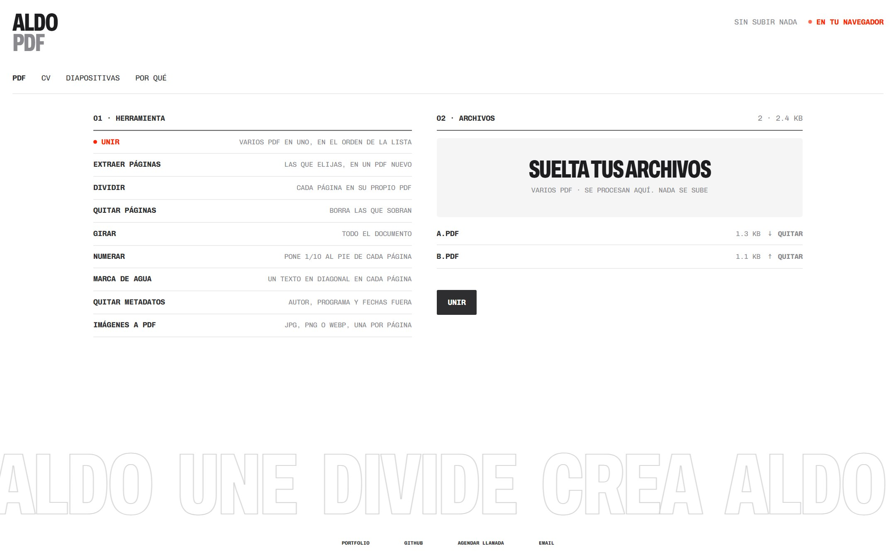
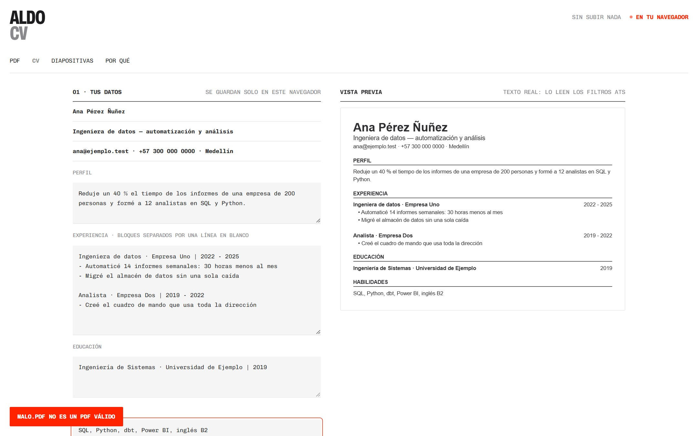
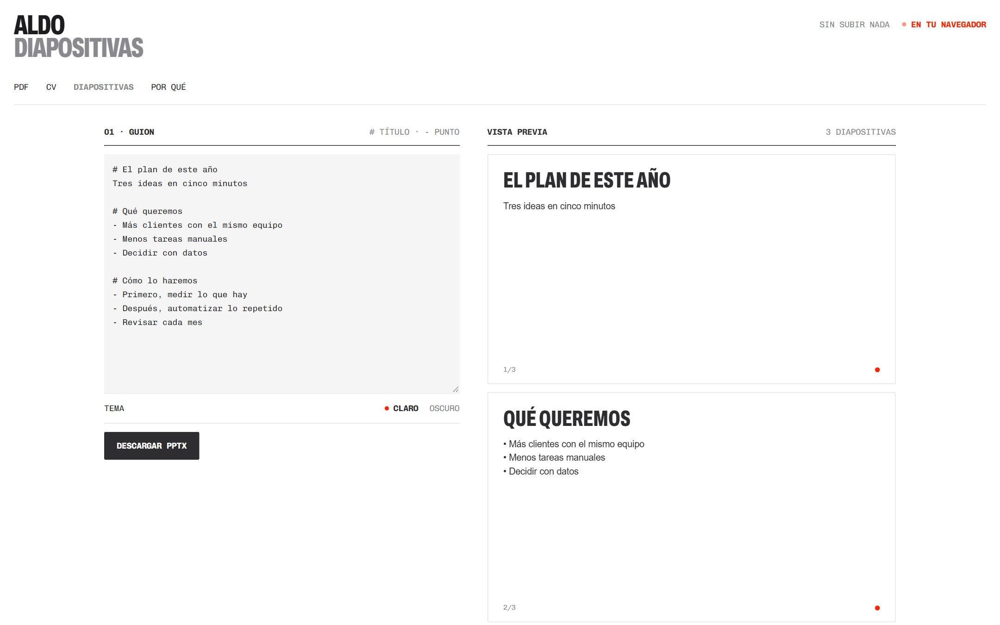
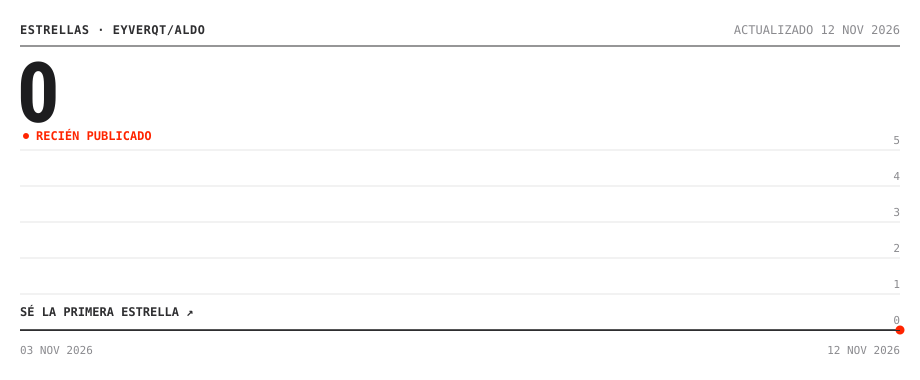

<h1>ALDO</h1>

<p><samp>DOCUMENTOS&nbsp;SIN&nbsp;SUBIR&nbsp;NADA&nbsp;&nbsp;&nbsp;&nbsp;&nbsp;&nbsp;<b>PDF,&nbsp;CV&nbsp;Y&nbsp;DIAPOSITIVAS</b>&nbsp;&nbsp;&nbsp;&nbsp;&nbsp;&nbsp;<b>●&nbsp;v1.0&nbsp;·&nbsp;PÚBLICO</b></samp></p>

<br>

<p align="center"></p>

<p align="center"><samp><a href="https://eyverqt.github.io/aldo/"><b>▶&nbsp;ABRIR&nbsp;ALDO</b></a>&nbsp;&nbsp;&nbsp;&nbsp;&nbsp;&nbsp;<a href="#por-que"><b>POR&nbsp;QUÉ&nbsp;ALDO</b></a>&nbsp;&nbsp;&nbsp;&nbsp;&nbsp;&nbsp;<a href="https://eyverqt.netlify.app"><b>PORTFOLIO</b></a></samp></p>

<br>

<p align="center"><samp>
<b>ALDO:&nbsp;&nbsp;&nbsp;&nbsp;&nbsp;&nbsp;&nbsp;&nbsp;&nbsp;&nbsp;&nbsp;&nbsp;&nbsp;&nbsp;&nbsp;&nbsp;&nbsp;(TUS&nbsp;ARCHIVOS&nbsp;NO&nbsp;SALEN&nbsp;DE&nbsp;TU&nbsp;NAVEGADOR)&nbsp;</b><br>
<br>
<b>ÍNDICE&nbsp;01:&nbsp;QUÉ&nbsp;HACE&nbsp;&nbsp;&nbsp;(NUEVE&nbsp;HERRAMIENTAS&nbsp;DE&nbsp;PDF,&nbsp;CV&nbsp;Y&nbsp;PPTX)&nbsp;&nbsp;</b><br>
<br>
<b>ÍNDICE&nbsp;02:&nbsp;NOVEDADES&nbsp;&nbsp;(v1.0:&nbsp;CUATRO&nbsp;APPS&nbsp;EN&nbsp;UNA)&nbsp;&nbsp;&nbsp;&nbsp;&nbsp;&nbsp;&nbsp;&nbsp;&nbsp;&nbsp;&nbsp;&nbsp;&nbsp;&nbsp;</b><br>
<br>
<b>ÍNDICE&nbsp;03:&nbsp;POR&nbsp;QUÉ&nbsp;&nbsp;&nbsp;&nbsp;(FRENTE&nbsp;A&nbsp;LO&nbsp;QUE&nbsp;YA&nbsp;EXISTE)&nbsp;&nbsp;&nbsp;&nbsp;&nbsp;&nbsp;&nbsp;&nbsp;&nbsp;&nbsp;&nbsp;&nbsp;&nbsp;</b><br>
<br>
<b>ÍNDICE&nbsp;04:&nbsp;USAR&nbsp;&nbsp;&nbsp;&nbsp;&nbsp;&nbsp;&nbsp;(SIN&nbsp;INSTALAR&nbsp;NADA)&nbsp;&nbsp;&nbsp;&nbsp;&nbsp;&nbsp;&nbsp;&nbsp;&nbsp;&nbsp;&nbsp;&nbsp;&nbsp;&nbsp;&nbsp;&nbsp;&nbsp;&nbsp;&nbsp;&nbsp;&nbsp;</b><br>
<br>
<b>ÍNDICE&nbsp;05:&nbsp;GALERÍA&nbsp;&nbsp;&nbsp;&nbsp;(CV&nbsp;Y&nbsp;DIAPOSITIVAS)&nbsp;&nbsp;&nbsp;&nbsp;&nbsp;&nbsp;&nbsp;&nbsp;&nbsp;&nbsp;&nbsp;&nbsp;&nbsp;&nbsp;&nbsp;&nbsp;&nbsp;&nbsp;&nbsp;&nbsp;&nbsp;</b><br>
<br>
<b>ÍNDICE&nbsp;06:&nbsp;LICENCIA&nbsp;&nbsp;&nbsp;(CÓDIGO&nbsp;MIT,&nbsp;CONTENIDO&nbsp;©&nbsp;EYVER&nbsp;GÓMEZ)&nbsp;&nbsp;&nbsp;</b><br>
<br>
<br>
<br>
Une,&nbsp;divide&nbsp;y&nbsp;edita&nbsp;PDF&nbsp;sin&nbsp;subirlos&nbsp;a&nbsp;ningún&nbsp;servidor.&nbsp;&nbsp;&nbsp;&nbsp;&nbsp;&nbsp;&nbsp;<br>
Escribe&nbsp;tu&nbsp;CV&nbsp;y&nbsp;descárgalo&nbsp;en&nbsp;un&nbsp;PDF&nbsp;que&nbsp;leen&nbsp;los&nbsp;filtros&nbsp;ATS.<br>
Pasa&nbsp;un&nbsp;guion&nbsp;de&nbsp;texto&nbsp;a&nbsp;una&nbsp;presentación&nbsp;PPTX&nbsp;editable.&nbsp;&nbsp;&nbsp;&nbsp;&nbsp;&nbsp;<br>
Sin&nbsp;instalar,&nbsp;sin&nbsp;cuenta&nbsp;y&nbsp;sin&nbsp;topes&nbsp;diarios.&nbsp;&nbsp;&nbsp;&nbsp;&nbsp;&nbsp;&nbsp;&nbsp;&nbsp;&nbsp;&nbsp;&nbsp;&nbsp;&nbsp;&nbsp;&nbsp;&nbsp;<br>
Una&nbsp;vez&nbsp;abierta&nbsp;funciona&nbsp;sin&nbsp;conexión.&nbsp;&nbsp;&nbsp;&nbsp;&nbsp;&nbsp;&nbsp;&nbsp;&nbsp;&nbsp;&nbsp;&nbsp;&nbsp;&nbsp;&nbsp;&nbsp;&nbsp;&nbsp;&nbsp;&nbsp;&nbsp;&nbsp;&nbsp;&nbsp;
</samp></p>

<br>

<p align="center"><samp>
<b>ÍNDICE&nbsp;01:&nbsp;QUÉ&nbsp;HACE&nbsp;&nbsp;&nbsp;(NUEVE&nbsp;HERRAMIENTAS&nbsp;DE&nbsp;PDF,&nbsp;CV&nbsp;Y&nbsp;PPTX)&nbsp;</b><br>
<br>
UNIR&nbsp;&nbsp;&nbsp;&nbsp;&nbsp;&nbsp;&nbsp;&nbsp;&nbsp;&nbsp;&nbsp;&nbsp;&nbsp;&nbsp;&nbsp;&nbsp;VARIOS&nbsp;PDF&nbsp;EN&nbsp;UNO,&nbsp;EN&nbsp;EL&nbsp;ORDEN&nbsp;QUE&nbsp;ELIJAS<br>
EXTRAER&nbsp;Y&nbsp;QUITAR&nbsp;&nbsp;&nbsp;&nbsp;PÁGINAS&nbsp;1-3,&nbsp;5,&nbsp;8-&nbsp;&nbsp;&nbsp;&nbsp;&nbsp;&nbsp;&nbsp;&nbsp;&nbsp;&nbsp;&nbsp;&nbsp;&nbsp;&nbsp;&nbsp;&nbsp;&nbsp;&nbsp;&nbsp;&nbsp;&nbsp;&nbsp;&nbsp;<br>
DIVIDIR&nbsp;&nbsp;&nbsp;&nbsp;&nbsp;&nbsp;&nbsp;&nbsp;&nbsp;&nbsp;&nbsp;&nbsp;&nbsp;CADA&nbsp;PÁGINA&nbsp;EN&nbsp;SU&nbsp;PROPIO&nbsp;PDF&nbsp;&nbsp;&nbsp;&nbsp;&nbsp;&nbsp;&nbsp;&nbsp;&nbsp;&nbsp;&nbsp;&nbsp;&nbsp;<br>
GIRAR&nbsp;Y&nbsp;NUMERAR&nbsp;&nbsp;&nbsp;&nbsp;&nbsp;90°,&nbsp;180°,&nbsp;270°&nbsp;Y&nbsp;1/10&nbsp;AL&nbsp;PIE&nbsp;&nbsp;&nbsp;&nbsp;&nbsp;&nbsp;&nbsp;&nbsp;&nbsp;&nbsp;&nbsp;&nbsp;<br>
MARCA&nbsp;DE&nbsp;AGUA&nbsp;&nbsp;&nbsp;&nbsp;&nbsp;&nbsp;&nbsp;UN&nbsp;TEXTO&nbsp;EN&nbsp;DIAGONAL&nbsp;&nbsp;&nbsp;&nbsp;&nbsp;&nbsp;&nbsp;&nbsp;&nbsp;&nbsp;&nbsp;&nbsp;&nbsp;&nbsp;&nbsp;&nbsp;&nbsp;&nbsp;&nbsp;&nbsp;&nbsp;<br>
QUITAR&nbsp;METADATOS&nbsp;&nbsp;&nbsp;&nbsp;AUTOR,&nbsp;PROGRAMA&nbsp;Y&nbsp;FECHAS&nbsp;FUERA&nbsp;&nbsp;&nbsp;&nbsp;&nbsp;&nbsp;&nbsp;&nbsp;&nbsp;&nbsp;&nbsp;<br>
IMÁGENES&nbsp;A&nbsp;PDF&nbsp;&nbsp;&nbsp;&nbsp;&nbsp;&nbsp;JPG,&nbsp;PNG&nbsp;O&nbsp;WEBP&nbsp;&nbsp;&nbsp;&nbsp;&nbsp;&nbsp;&nbsp;&nbsp;&nbsp;&nbsp;&nbsp;&nbsp;&nbsp;&nbsp;&nbsp;&nbsp;&nbsp;&nbsp;&nbsp;&nbsp;&nbsp;&nbsp;&nbsp;&nbsp;&nbsp;&nbsp;<br>
CV&nbsp;&nbsp;&nbsp;&nbsp;&nbsp;&nbsp;&nbsp;&nbsp;&nbsp;&nbsp;&nbsp;&nbsp;&nbsp;&nbsp;&nbsp;&nbsp;&nbsp;&nbsp;UNA&nbsp;COLUMNA&nbsp;Y&nbsp;TEXTO&nbsp;REAL,&nbsp;A4&nbsp;O&nbsp;CARTA&nbsp;&nbsp;&nbsp;&nbsp;&nbsp;<br>
DIAPOSITIVAS&nbsp;&nbsp;&nbsp;&nbsp;&nbsp;&nbsp;&nbsp;&nbsp;#&nbsp;TÍTULO&nbsp;·&nbsp;-&nbsp;PUNTO&nbsp;→&nbsp;PPTX&nbsp;EDITABLE&nbsp;&nbsp;&nbsp;&nbsp;&nbsp;&nbsp;&nbsp;
</samp></p>

<br>

<p align="center"><samp>
<b>ÍNDICE&nbsp;02:&nbsp;NOVEDADES&nbsp;&nbsp;(v1.0:&nbsp;CUATRO&nbsp;APPS&nbsp;EN&nbsp;UNA)&nbsp;&nbsp;&nbsp;&nbsp;&nbsp;&nbsp;&nbsp;&nbsp;&nbsp;&nbsp;&nbsp;&nbsp;&nbsp;&nbsp;&nbsp;&nbsp;&nbsp;&nbsp;&nbsp;&nbsp;&nbsp;&nbsp;&nbsp;&nbsp;&nbsp;</b><br>
<br>
<b>2026-11&nbsp;·&nbsp;ALDO&nbsp;1.0&nbsp;&nbsp;&nbsp;&nbsp;&nbsp;&nbsp;&nbsp;&nbsp;&nbsp;&nbsp;&nbsp;&nbsp;&nbsp;&nbsp;&nbsp;&nbsp;&nbsp;&nbsp;&nbsp;&nbsp;&nbsp;&nbsp;&nbsp;&nbsp;&nbsp;&nbsp;&nbsp;&nbsp;&nbsp;&nbsp;&nbsp;&nbsp;&nbsp;&nbsp;&nbsp;&nbsp;&nbsp;&nbsp;&nbsp;&nbsp;&nbsp;&nbsp;&nbsp;&nbsp;&nbsp;&nbsp;&nbsp;&nbsp;&nbsp;&nbsp;&nbsp;&nbsp;&nbsp;&nbsp;&nbsp;</b><br>
<br>
Reúne&nbsp;la&nbsp;idea&nbsp;de&nbsp;Morfo&nbsp;PDF,&nbsp;Presenta&nbsp;y&nbsp;Generador&nbsp;CV&nbsp;en&nbsp;una&nbsp;web&nbsp;sin&nbsp;build.<br>
La&nbsp;generación&nbsp;con&nbsp;Gemini&nbsp;de&nbsp;Estudia&nbsp;IA&nbsp;se&nbsp;queda&nbsp;fuera&nbsp;a&nbsp;propósito:&nbsp;&nbsp;&nbsp;&nbsp;&nbsp;&nbsp;&nbsp;<br>
obligaba&nbsp;a&nbsp;usar&nbsp;una&nbsp;clave&nbsp;y&nbsp;mandar&nbsp;tus&nbsp;documentos&nbsp;a&nbsp;una&nbsp;nube.&nbsp;&nbsp;&nbsp;&nbsp;&nbsp;&nbsp;&nbsp;&nbsp;&nbsp;&nbsp;&nbsp;&nbsp;
</samp></p>

<br>

<a id="por-que"></a>

<p align="center"><samp>
<b>ÍNDICE&nbsp;03:&nbsp;POR&nbsp;QUÉ&nbsp;&nbsp;&nbsp;&nbsp;(FRENTE&nbsp;A&nbsp;LO&nbsp;QUE&nbsp;YA&nbsp;EXISTE)&nbsp;&nbsp;&nbsp;&nbsp;&nbsp;&nbsp;&nbsp;&nbsp;&nbsp;&nbsp;&nbsp;&nbsp;&nbsp;&nbsp;&nbsp;&nbsp;&nbsp;&nbsp;</b><br>
<br>
SMALLPDF&nbsp;&nbsp;&nbsp;&nbsp;&nbsp;&nbsp;NUBE,&nbsp;UNAS&nbsp;2&nbsp;TAREAS&nbsp;AL&nbsp;DÍA&nbsp;GRATIS&nbsp;&nbsp;&nbsp;&nbsp;&nbsp;&nbsp;&nbsp;&nbsp;&nbsp;&nbsp;&nbsp;&nbsp;&nbsp;&nbsp;&nbsp;&nbsp;&nbsp;&nbsp;&nbsp;&nbsp;<br>
ILOVEPDF&nbsp;&nbsp;&nbsp;&nbsp;&nbsp;&nbsp;CÓMODO,&nbsp;PERO&nbsp;SUBE&nbsp;LOS&nbsp;ARCHIVOS&nbsp;A&nbsp;SUS&nbsp;SERVIDORES&nbsp;&nbsp;&nbsp;&nbsp;&nbsp;&nbsp;<br>
STIRLING-PDF&nbsp;&nbsp;MÁS&nbsp;DE&nbsp;50&nbsp;FUNCIONES,&nbsp;PERO&nbsp;HAY&nbsp;QUE&nbsp;MONTAR&nbsp;SERVIDOR&nbsp;&nbsp;&nbsp;&nbsp;<br>
<br>
<b>LO&nbsp;QUE&nbsp;ALDO&nbsp;HACE&nbsp;DISTINTO:&nbsp;&nbsp;&nbsp;&nbsp;&nbsp;&nbsp;&nbsp;&nbsp;&nbsp;&nbsp;&nbsp;&nbsp;&nbsp;&nbsp;&nbsp;&nbsp;&nbsp;&nbsp;&nbsp;&nbsp;&nbsp;&nbsp;&nbsp;&nbsp;&nbsp;&nbsp;&nbsp;&nbsp;&nbsp;&nbsp;&nbsp;&nbsp;&nbsp;&nbsp;&nbsp;&nbsp;&nbsp;&nbsp;&nbsp;&nbsp;&nbsp;</b><br>
<br>
●&nbsp;PRIVADO&nbsp;&nbsp;&nbsp;&nbsp;&nbsp;&nbsp;&nbsp;(LA&nbsp;CSP&nbsp;IMPIDE&nbsp;ENVIAR&nbsp;NADA&nbsp;A&nbsp;NINGÚN&nbsp;SITIO)&nbsp;&nbsp;&nbsp;&nbsp;&nbsp;&nbsp;&nbsp;&nbsp;&nbsp;<br>
●&nbsp;SIN&nbsp;TOPES&nbsp;&nbsp;&nbsp;&nbsp;&nbsp;(SIN&nbsp;LÍMITE&nbsp;DE&nbsp;TAREAS:&nbsp;TRABAJA&nbsp;TU&nbsp;EQUIPO)&nbsp;&nbsp;&nbsp;&nbsp;&nbsp;&nbsp;&nbsp;&nbsp;&nbsp;&nbsp;<br>
●&nbsp;SIN&nbsp;CONEXIÓN&nbsp;&nbsp;(INSTALABLE&nbsp;COMO&nbsp;APP)&nbsp;&nbsp;&nbsp;&nbsp;&nbsp;&nbsp;&nbsp;&nbsp;&nbsp;&nbsp;&nbsp;&nbsp;&nbsp;&nbsp;&nbsp;&nbsp;&nbsp;&nbsp;&nbsp;&nbsp;&nbsp;&nbsp;&nbsp;&nbsp;&nbsp;&nbsp;&nbsp;&nbsp;&nbsp;&nbsp;<br>
●&nbsp;TODO&nbsp;JUNTO&nbsp;&nbsp;&nbsp;&nbsp;(PDF,&nbsp;CV&nbsp;Y&nbsp;DIAPOSITIVAS&nbsp;EN&nbsp;UN&nbsp;SITIO)&nbsp;&nbsp;&nbsp;&nbsp;&nbsp;&nbsp;&nbsp;&nbsp;&nbsp;&nbsp;&nbsp;&nbsp;&nbsp;&nbsp;&nbsp;<br>
<br>
<b>LO&nbsp;QUE&nbsp;NO&nbsp;HACE:&nbsp;&nbsp;&nbsp;&nbsp;&nbsp;&nbsp;&nbsp;&nbsp;&nbsp;&nbsp;&nbsp;&nbsp;&nbsp;&nbsp;&nbsp;&nbsp;&nbsp;&nbsp;&nbsp;&nbsp;&nbsp;&nbsp;&nbsp;&nbsp;&nbsp;&nbsp;&nbsp;&nbsp;&nbsp;&nbsp;&nbsp;&nbsp;&nbsp;&nbsp;&nbsp;&nbsp;&nbsp;&nbsp;&nbsp;&nbsp;&nbsp;&nbsp;&nbsp;&nbsp;&nbsp;&nbsp;&nbsp;&nbsp;&nbsp;&nbsp;&nbsp;&nbsp;</b><br>
<br>
No&nbsp;comprime,&nbsp;no&nbsp;convierte&nbsp;a&nbsp;Word&nbsp;y&nbsp;no&nbsp;aplica&nbsp;OCR:&nbsp;eso&nbsp;exige&nbsp;motores<br>
pesados.&nbsp;Para&nbsp;eso,&nbsp;Stirling-PDF.&nbsp;No&nbsp;abre&nbsp;PDF&nbsp;con&nbsp;contraseña.&nbsp;&nbsp;&nbsp;&nbsp;&nbsp;&nbsp;&nbsp;
</samp></p>

<br>

<p align="center"><samp>
<b>ÍNDICE&nbsp;04:&nbsp;USAR&nbsp;&nbsp;&nbsp;&nbsp;&nbsp;&nbsp;&nbsp;(SIN&nbsp;INSTALAR&nbsp;NADA)&nbsp;&nbsp;&nbsp;&nbsp;&nbsp;&nbsp;&nbsp;&nbsp;&nbsp;&nbsp;&nbsp;&nbsp;&nbsp;&nbsp;&nbsp;&nbsp;&nbsp;&nbsp;&nbsp;&nbsp;&nbsp;&nbsp;&nbsp;&nbsp;&nbsp;&nbsp;&nbsp;&nbsp;&nbsp;&nbsp;&nbsp;&nbsp;&nbsp;&nbsp;&nbsp;</b><br>
<br>
ABRE&nbsp;&nbsp;&nbsp;&nbsp;&nbsp;&nbsp;&nbsp;&nbsp;&nbsp;&nbsp;EYVERQT.GITHUB.IO/ALDO&nbsp;&nbsp;&nbsp;&nbsp;&nbsp;&nbsp;&nbsp;&nbsp;&nbsp;&nbsp;&nbsp;&nbsp;&nbsp;&nbsp;&nbsp;&nbsp;&nbsp;&nbsp;&nbsp;&nbsp;&nbsp;&nbsp;&nbsp;&nbsp;&nbsp;&nbsp;&nbsp;&nbsp;&nbsp;&nbsp;&nbsp;&nbsp;&nbsp;&nbsp;&nbsp;&nbsp;&nbsp;&nbsp;&nbsp;&nbsp;<br>
PDF&nbsp;&nbsp;&nbsp;&nbsp;&nbsp;&nbsp;&nbsp;&nbsp;&nbsp;&nbsp;&nbsp;ELIGE&nbsp;HERRAMIENTA,&nbsp;SUELTA&nbsp;ARCHIVOS&nbsp;Y&nbsp;LISTO&nbsp;&nbsp;&nbsp;&nbsp;&nbsp;&nbsp;&nbsp;&nbsp;&nbsp;&nbsp;&nbsp;&nbsp;&nbsp;&nbsp;&nbsp;&nbsp;&nbsp;&nbsp;&nbsp;&nbsp;<br>
CV&nbsp;&nbsp;&nbsp;&nbsp;&nbsp;&nbsp;&nbsp;&nbsp;&nbsp;&nbsp;&nbsp;&nbsp;RELLENA,&nbsp;MIRA&nbsp;LA&nbsp;VISTA&nbsp;PREVIA&nbsp;Y&nbsp;DESCARGA&nbsp;&nbsp;&nbsp;&nbsp;&nbsp;&nbsp;&nbsp;&nbsp;&nbsp;&nbsp;&nbsp;&nbsp;&nbsp;&nbsp;&nbsp;&nbsp;&nbsp;&nbsp;&nbsp;&nbsp;&nbsp;&nbsp;<br>
DIAPOSITIVAS&nbsp;&nbsp;ESCRIBE&nbsp;EL&nbsp;GUION&nbsp;Y&nbsp;DESCARGA&nbsp;EL&nbsp;PPTX&nbsp;&nbsp;&nbsp;&nbsp;&nbsp;&nbsp;&nbsp;&nbsp;&nbsp;&nbsp;&nbsp;&nbsp;&nbsp;&nbsp;&nbsp;&nbsp;&nbsp;&nbsp;&nbsp;&nbsp;&nbsp;&nbsp;&nbsp;&nbsp;&nbsp;&nbsp;&nbsp;<br>
<br>
Para&nbsp;instalarla:&nbsp;en&nbsp;Chrome&nbsp;o&nbsp;Edge,&nbsp;botón&nbsp;Instalar&nbsp;de&nbsp;la&nbsp;barra&nbsp;de&nbsp;direcciones
</samp></p>

<br>

<p align="center"><samp>
<b>ÍNDICE&nbsp;05:&nbsp;GALERÍA&nbsp;&nbsp;&nbsp;&nbsp;(CV&nbsp;Y&nbsp;DIAPOSITIVAS)</b>
</samp></p>

<p align="center">&nbsp;</p>


<details>
<summary><samp><b>ESTRUCTURA&nbsp;DEL&nbsp;PROYECTO</b></samp></summary>

```text
aldo/
├── index.html · 404.html  # La página y las rutas limpias en GitHub Pages
├── documentos.js          # PDF, CV y PPTX, sin tocar la página
├── app.js · app.css       # Interfaz con el estilo eyverqt
├── vendor/                # pdf-lib y PptxGenJS (MIT), servidos desde aquí
├── sw.js                  # Sin conexión
└── scripts/estrellas.py   # La gráfica de estrellas (GitHub Actions)
```

</details>

<br>

<p align="center"><samp>
<b>ÍNDICE&nbsp;06:&nbsp;LICENCIA&nbsp;&nbsp;&nbsp;(CÓDIGO&nbsp;MIT,&nbsp;CONTENIDO&nbsp;©&nbsp;EYVER&nbsp;GÓMEZ)&nbsp;&nbsp;&nbsp;&nbsp;&nbsp;&nbsp;&nbsp;&nbsp;&nbsp;&nbsp;&nbsp;&nbsp;&nbsp;&nbsp;</b><br>
<br>
Código&nbsp;bajo&nbsp;MIT.&nbsp;Contenido&nbsp;y&nbsp;diseño&nbsp;©&nbsp;Eyver&nbsp;Gómez.&nbsp;&nbsp;&nbsp;&nbsp;&nbsp;&nbsp;&nbsp;&nbsp;&nbsp;&nbsp;&nbsp;&nbsp;&nbsp;&nbsp;&nbsp;&nbsp;&nbsp;&nbsp;&nbsp;&nbsp;&nbsp;&nbsp;&nbsp;<br>
pdf-lib&nbsp;y&nbsp;PptxGenJS&nbsp;(MIT)&nbsp;mantienen&nbsp;sus&nbsp;licencias&nbsp;en&nbsp;vendor/.&nbsp;&nbsp;&nbsp;&nbsp;&nbsp;&nbsp;&nbsp;&nbsp;&nbsp;&nbsp;&nbsp;&nbsp;<br>
Sin&nbsp;analíticas&nbsp;ni&nbsp;cookies.&nbsp;El&nbsp;borrador&nbsp;del&nbsp;CV&nbsp;queda&nbsp;solo&nbsp;en&nbsp;tu&nbsp;navegador.
</samp></p>

<br>

<p align="center"><samp>
<b>ESTRELLAS:&nbsp;&nbsp;&nbsp;&nbsp;&nbsp;&nbsp;&nbsp;&nbsp;&nbsp;&nbsp;&nbsp;&nbsp;(SE&nbsp;REDIBUJA&nbsp;SOLA&nbsp;CON&nbsp;CADA&nbsp;ESTRELLA)</b>
</samp></p>

<p align="center"><a href="https://github.com/eyverqt/aldo/stargazers"></a></p>

<br>

<p align="center"><sub><samp><a href="https://eyverqt.netlify.app"><b>PORTFOLIO</b></a>&nbsp;&nbsp;&nbsp;&nbsp;&nbsp;&nbsp;<a href="https://github.com/eyverqt"><b>GITHUB</b></a>&nbsp;&nbsp;&nbsp;&nbsp;&nbsp;&nbsp;<a href="https://cal.com/eyverqt/15min"><b>AGENDAR&nbsp;LLAMADA</b></a>&nbsp;&nbsp;&nbsp;&nbsp;&nbsp;&nbsp;<a href="https://wa.me/573127115299"><b>WHATSAPP</b></a>&nbsp;&nbsp;&nbsp;&nbsp;&nbsp;&nbsp;<a href="mailto:eyverqt@gmail.com"><b>EMAIL</b></a>&nbsp;&nbsp;&nbsp;&nbsp;&nbsp;&nbsp;<a href="LICENSE"><b>LICENCIA</b></a></samp></sub></p>
